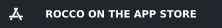
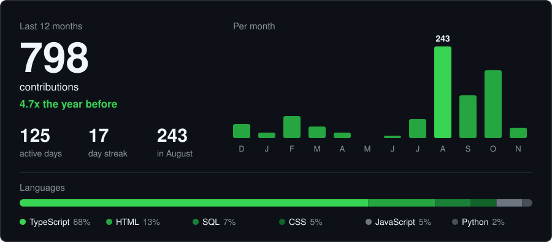
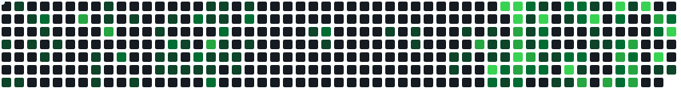

### About me

Computer Science graduate from Özyeğin (2026). I took Hedian from idea to the App Store on my own, and I'm building Rocco and Markapping now. Engineering is my background, product is where I want to build next.

### What I'm building

<table>
  <tr>
    <td width="72"></td>
    <td><b><a href="https://apps.apple.com/app/id6820277478">Rocco</a></b> Real chores grow a virtual home. iOS, live on the App Store.</td>
  </tr>
  <tr>
    <td></td>
    <td><b><a href="https://hedian.app">Hedian</a></b> Share a Reel, TikTok or YouTube video and get it explained. iOS, live on the App Store.</td>
  </tr>
  <tr>
    <td></td>
    <td><b><a href="https://markapping.com">Markapping</a></b> Creators get paid per view, so app owners only pay for content that gets watched. In beta.</td>
  </tr>
  <tr>
    <td></td>
    <td><b><a href="https://home.whitepaperiq.com/">WhitepaperIQ</a></b> AI reports on Web3 projects, used by Turkish banks and exchanges. Built the frontend and blockchain side at Trio Blockchain Labs.</td>
  </tr>
</table>

### Tools I use

### GitHub stats

 
 

<picture>
  <source media="(prefers-color-scheme: dark)" srcset="https://raw.githubusercontent.com/kXrock/kXrock/output/snake-dark.svg" />
  <source media="(prefers-color-scheme: light)" srcset="https://raw.githubusercontent.com/kXrock/kXrock/output/snake-light.svg" />
  
</picture>

